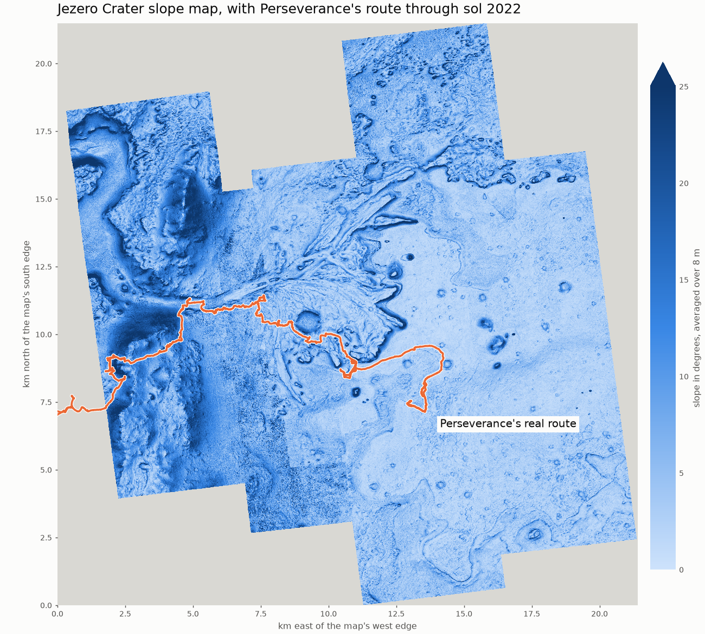
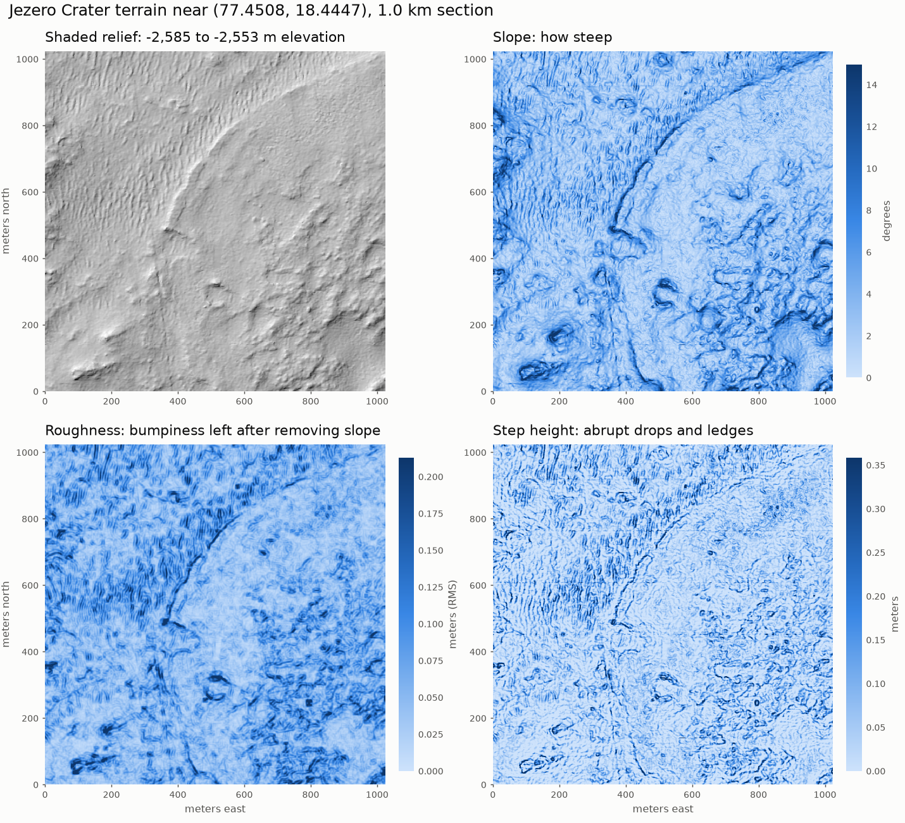

# Mars Route Planner

**What can orbital data explain about how Perseverance actually drives?**

This project plans rover routes across real terrain in Jezero Crater, then compares them with the
drives Perseverance actually made. The places where they disagree show what orbital data can and
can't explain.

> Work in progress. Independent student project, not affiliated with or endorsed by NASA or USGS.
> Not for real mission planning.

## Status

| Stage | Goal | Status |
|---|---|---|
| 1 | Terrain engine: load huge maps, measure slope, roughness and step height | Done |
| 2 | Rover model: hazard limits and energy | Not started |
| 3 | Route planner | Not started |
| 4 | Replay real drives and measure differences | Not started |
| 5 | Estimate what the real drives prioritized | Not started |
| 6+ | Vision, uncertainty, new mission and public website | Not started |

## Early results



The full 21 x 21 km map took 6.2 minutes to process on a laptop, using about 0.84 GB of RAM when
checked mid-run. Five sections crossing tile boundaries matched a one-piece recalculation. 66% of the
map has data, because the mosaic's image strips don't fill the whole rectangle. 93.6% of the route's
points fall inside the map, and the rest are beyond its western edge.



From a 2 km x 2 km section around the landing site, compared with 112 rover stops:

- **Slope vs. rover tilt:** orbital slope correlates with the rover's tilt at r = 0.88 (median 2.21
  vs. 2.57 degrees). The stops are clustered along one path, so they aren't fully independent.
- **Elevation vs. rover:** they differ by only 0.01 m on average (SD 0.04 m). This is probably not
  independent evidence, because NASA's published stop elevations may come from this same map.
- **Map artifact found:** 19 of 2,047 rows have abrupt jumps compared with nearby rows, and 0 of
  2,047 columns do. Real terrain has no reason to favor one direction, so these are likely flaws
  in the map. Their effect on routes hasn't been measured yet.

## Run it

Requires Python 3.11 or newer on Windows PowerShell:

```powershell
python -m venv .venv
.\.venv\Scripts\python.exe -m pip install -r requirements.txt
.\.venv\Scripts\python.exe -m pytest tests
.\.venv\Scripts\python.exe -m mars_rover.cli sample --size 1024
.\.venv\Scripts\python.exe -m scripts.check_against_rover
```

`sample` and the rover check read small parts of the map over the internet, without downloading the
whole file. To reproduce the full-map results, which need about 6 GB of free disk space:

```powershell
.\.venv\Scripts\python.exe -m scripts.download_data
.\.venv\Scripts\python.exe -m mars_rover.cli process --source data\raw\JEZ_hirise_soc_006_DTM_MOLAtopography_DeltaGeoid_1m_Eqc_latTs0_lon0_blend40.tif
.\.venv\Scripts\python.exe -m scripts.verify_full_map
```

## How the terrain engine works

- **Reads in pieces:** the map has about 460 million cells, so it's handled in tiles that overlap
  just enough to prevent seams. Tests confirm tiled and whole-map results match.
- **Corrects distances:** this map projection stretches east-west distances, so a "1 m" cell at
  Jezero is about 0.95 m wide. Without the correction, east-west slopes come out about 5% too low.
- **Never treats missing data as safe:** any result that depends on a missing cell is itself missing.
- **Slope:** Horn's 3 x 3 method.
- **Roughness:** root-mean-square difference from a best-fit plane over 11 m. A smooth hill scores zero.
- **Step height:** height range over 3 m, minus what the local slope explains. It reads about 14% low
  on a sharp ledge. Measured on a 1 m map, it can't see small rocks.

## Credits

**Data:** USGS Astrogeology and NASA. See [docs/DATA.md](docs/DATA.md) for sources and citations.

**AI use:** this project is built with substantial help from Claude, Anthropic's AI assistant. Claude
wrote the Stage 1 code, tests and documentation, and identified the issues described above. This
section will be updated as the project continues, to show which decisions, code and analysis are
mine.
