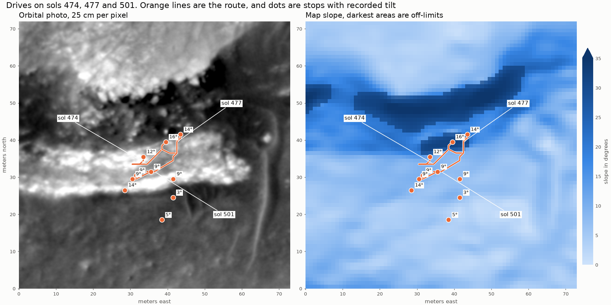
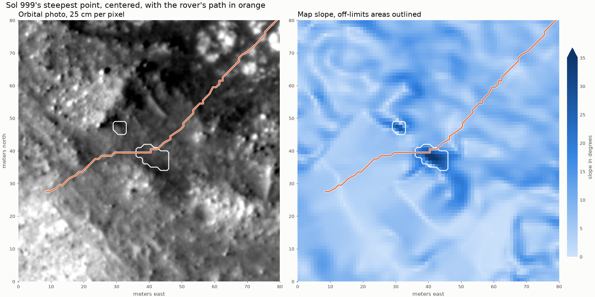
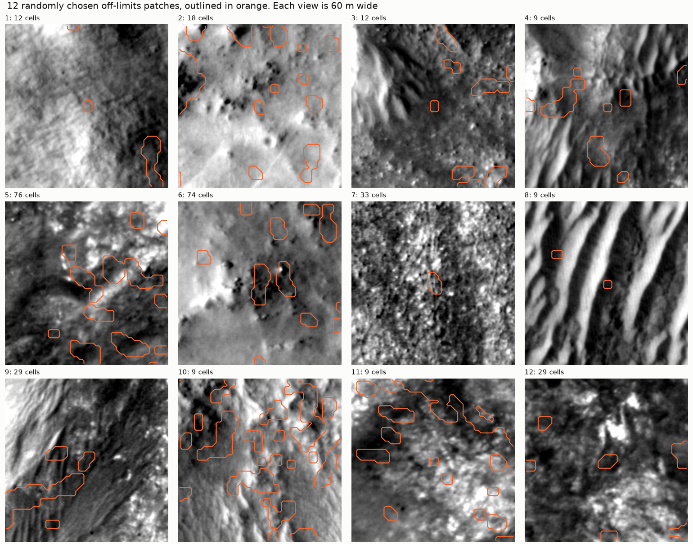

# Stage 2 evidence: how cautious should the rover model be?

Gathered by Claude. The limits chosen for the model will be recorded separately as my own decision.

## Published rover limits

| Property | Value | Source |
|---|---|---|
| Size | 3 m long, 2.7 m wide, 2.2 m tall | [NASA rover components](https://science.nasa.gov/mission/mars-2020-perseverance/rover-components/) (check this figure against the page) |
| Tilt it can survive | 45 degrees in any direction | NASA rover components |
| Tilt drivers avoid | More than 30 degrees | NASA rover components |
| Obstacles it can cross | About as large as a wheel, 52.5 cm | NASA rover components |
| Top speed on flat, hard ground | About 150 m per hour (4.2 cm/s) | NASA rover components, [JPL mobility page](https://robotics.jpl.nasa.gov/what-we-do/flight-projects/mars-2020-rover/m2020mobility/) |
| Generator power | About 110 W at the start of the mission, falling a few percent a year | [JPL press kit](https://www.jpl.nasa.gov/news/press_kits/mars_2020/launch/mission/spacecraft/power/) |
| Peak power demand | Up to 900 W, using batteries | JPL press kit |

These figures come from search excerpts of the linked pages, so confirm them against the pages before
quoting them.

**Not found so far:** a published energy use per meter of driving, an exact maximum slope for driving, or a
hard ledge limit beyond the wheel-size rule. The energy model will need clearly labeled assumptions.
The likely next sources are [Verma et al. (2023)](https://doi.org/10.1126/scirobotics.adi3099) and the ENav
paper by Toupet et al.

## What the rover actually drove across

From `python -m scripts.route_terrain_stats`, using the route through sol 2022. "Under route" is the map cell
under the path. "Worst in 3 x 3 m" is the highest value in a rover-sized square around it. "Nearby" is a random
sample within about 500 m of the route.

| Slope above | Under route | Worst in 3 x 3 m | Nearby |
|---|---|---|---|
| 15 degrees | 7.19% | 11.89% | 16.42% |
| 20 degrees | 0.69% | 1.58% | 7.05% |
| 25 degrees | 0.04% | 0.10% | 2.17% |
| 30 degrees | 0.01% | 0.02% | 0.54% |

| Step height above | Under route | Worst in 3 x 3 m | Nearby |
|---|---|---|---|
| 0.3 m | 1.17% | 3.20% | 2.89% |
| 0.525 m | 0.12% | 0.32% | 0.54% |

| Roughness above | Under route | Worst in 3 x 3 m | Nearby |
|---|---|---|---|
| 0.2 m | 1.13% | 2.13% | 4.39% |
| 0.3 m | 0.16% | 0.29% | 1.00% |

**Rover tilt at 708 stops:** median 7.03 degrees, maximum 20.68 degrees, and none above 25 degrees.

## Limits of this evidence

- **Avoiding steep ground isn't proven:** the route has far less steep ground than its surroundings, which fits
  deliberate avoidance. But science goals and the shape of the land could also explain some of it.
- **Slope isn't tilt:** map slope is measured over a few meters, while tilt depends on the rover's whole body
  and where its wheels sit. The tilt limit can't be applied to map slope without an assumption.
- **Tilt is only recorded at stops:** the rover could have tilted more while driving.
- **Some extreme values may be errors:** a map flaw or a small error in the rover's position could explain the
  highest values under the route, such as a 1.30 m step.
- **Gaps:** 8.6% of the route's map cells have no data, and 2,354 route points are off the map.

## Testing the hazard model on the real drives

From `python -m scripts.check_hazards_against_route`, using the 25 degree limit in
[decisions.md](decisions.md):

| Ground | Unknown | Safe | Risky | Off-limits |
|---|---|---|---|---|
| Under the route (26,030 cells) | 8.74% | 90.78% | 0.39% | 0.09% |
| Nearby (200,000 cells) | 10.53% | 84.79% | 1.48% | 3.20% |

- **Drives:** 8 of the 526 drives with points on the map touch off-limits ground.
- **Connectivity:** all of the route's drivable cells fall in one connected region of about 84 km^2, so off-limits
  ground doesn't cut the route apart. This doesn't show that a planner would choose the same path.
- **Worst cases:** sols 474, 477 and 501 are close together in time and include the highest share of off-limits
  points, up to 16 of 24 on sol 477. Why they exceed the limit hasn't been investigated.
- **Energy:** the model estimates 14.3 kWh over the 39.79 km with terrain data, or 1,293 J per meter, compared
  with 1,141 J per meter on flat ground. These depend on assumed values and haven't been checked against
  real rover energy use, so they're only useful for comparing routes.
- **Length check:** route coordinates inside the map add up to 43.21 km. NASA's lengths for those same drives add
  up to 43.49 km, including any parts that run off the map.

## How much the slope limit matters

From `python -m scripts.slope_limit_sensitivity`. This shows how sensitive the results are, and doesn't choose a
limit, because every row comes from the same route. The 25 degree row matches the hazard check above.

| Limit | Route off-limits | Nearby off-limits | Nearby vs. route | Drives touching (of 526) | Route points off-limits |
|---|---|---|---|---|---|
| 20 degrees | 1.452% | 8.893% | 6 times | 74 | 668 |
| 22 degrees | 0.496% | 6.210% | 13 times | 41 | 239 |
| 25 degrees | 0.092% | 3.199% | 35 times | 8 | 47 |
| 27 degrees | 0.046% | 1.969% | 43 times | 4 | 29 |
| 30 degrees | 0.019% | 0.906% | 48 times | 1 | 5 |

- **Sensitivity:** tightening from 25 to 20 degrees raises the drives touching off-limits ground from 8 to 74.
  Loosening from 25 to 30 degrees lowers them to 1, and shrinks off-limits nearby ground from 3.20% to 0.91%.
- **Connectivity:** at every limit, the route's drivable cells stay in one connected region, so connectivity
  doesn't help choose between these limits.
- **Not settled:** a higher "nearby vs. route" number doesn't make a limit better, because it partly reflects
  the rarity of very steep ground. Comparing limits fairly needs planned routes and drives held back for testing.

## Why do real drives cross off-limits ground?

From `python -m scripts.investigate_steep_drives`. No prediction was written down before this ran.

| Sol | Off-limits points | Steepest in 3 x 3 m | Farthest from drivable ground | Tilt at start, end |
|---|---|---|---|---|
| 474 | 6 of 17 | 28.6 degrees | 3.0 m | 12.3, 16.0 degrees |
| 477 | 16 of 24 | 28.6 degrees | 3.0 m | 16.0, 13.9 degrees |
| 501 | 4 of 20 | 27.3 degrees | 2.0 m | 13.9, 9.4 degrees |
| 999 | 7 of 192 | 36.9 degrees | 2.8 m | 10.9, 3.5 degrees |
| 1252 | 5 of 44 | 26.0 degrees | 2.0 m | 17.2, 17.8 degrees |
| 1288 | 5 of 52 | 25.1 degrees | 2.0 m | 14.9, 13.6 degrees |
| 1292 | 2 of 25 | 26.0 degrees | 1.0 m | 13.6, 14.8 degrees |
| 1688 | 2 of 280 | 27.0 degrees | 1.0 m | 12.0, 14.4 degrees |

Map slope compared with recorded tilt at 611 stops:

| Steepest map slope in 3 x 3 m | Stops | Mean tilt | Highest tilt |
|---|---|---|---|
| 0 to 10 degrees | 365 | 3.9 degrees | 14.4 degrees |
| 10 to 15 degrees | 137 | 10.4 degrees | 18.3 degrees |
| 15 to 20 degrees | 82 | 14.0 degrees | 20.1 degrees |
| 20 to 25 degrees | 26 | 17.3 degrees | 20.7 degrees |
| Above 25 degrees | 1 | 16.0 degrees | 16.0 degrees |

Tilt correlates with the map slope under each stop at r = 0.886.

| Possible explanation | What the evidence says | Current view |
|---|---|---|
| The map is simply wrong | The photo shows a real outcrop edge where the map shows steep ground | Unlikely to be the whole story |
| The rover really tilted about 28 degrees | Tilt at nearby stops is 9 to 16 degrees, but tilt during drives isn't recorded | No evidence for it, but not ruled out |
| The recorded position is slightly off | Every off-limits point is within 3 m of drivable ground | Possible. The size of the position error is unknown |
| Small-scale map slope overstates rover tilt | At stops, tilt runs below map slope, and the gap grows on steeper ground | Best supported so far, but see the limits below |
| The drivers went there on purpose | Short drives and several stops beside a bright outcrop | Fits, but mission records haven't been checked |

**Limits:**

- **The tilt gap is partly built in:** this compares tilt with the steepest of 9 cells, which tends to run high, and
  grouping stops by map slope exaggerates the pattern. It doesn't prove how much map slope overstates tilt.
- **Very few steep stops:** only 1 stop is above 25 degrees, so the steep end has little evidence.
- **Only three drives were examined closely:** the 36.9 degree value on sol 999 hasn't been checked.

## Testing the suspension idea

**Idea tested:** if the suspension smooths out small bumps, recorded tilt should match map slope best when slope is
measured over a window close to the rover's size. From `python -m scripts.test_suspension_idea`, using the same 611
stops at 79 sites for every window. No prediction was written down before this ran.

| Window | Average error | Map minus tilt | Correlation |
|---|---|---|---|
| 3 m | 1.89 degrees | +0.28 degrees | 0.887 |
| 5 m | 1.72 degrees | +0.18 degrees | 0.905 |
| 7 m | 1.57 degrees | +0.07 degrees | 0.919 |
| 9 m | 1.45 degrees | -0.02 degrees | 0.929 |
| 11 m | 1.37 degrees | -0.10 degrees | 0.934 |
| 15 m | 1.31 degrees | -0.22 degrees | 0.937 |
| 21 m | 1.35 degrees | -0.33 degrees | 0.933 |

- **Wider windows match better:** compared with 3 m, the 15 m window cuts average error by 0.42 to 0.75 degrees (95%
  range, resampling whole sites). It was the best window in 95.9% of trials.
- **The best window is much wider than the rover:** about 15 m, compared with a rover about 3 m long. That doesn't
  fit the idea as stated. Map noise or position error could explain the improvement instead, though the suspension
  could still play some part.
- **Correction to the table above:** map slope doesn't run far above tilt on average. A 3 m window is only 0.28
  degrees higher, and at stops with at least 10 degrees of tilt it's 0.26 degrees lower. The larger gaps in the earlier
  table mostly came from comparing against the steepest of 9 cells and grouping stops by map slope. So the earlier
  "best supported" view of map slope overstating tilt was too strong.
- **What makes the model cautious:** taking the steepest slope in a 3 x 3 m footprint, rather than map slope itself.
- **Limits:** tilt is only recorded at stops, which drivers may choose partly because they're flat. This also doesn't
  explain the local gap beside the outcrop on sols 474 to 501.

## Stage 2 follow-up checks

From `python -m scripts.stage2_followups`.

### Sol 999's 36.9 degree reading

| Window | 3 m | 5 m | 7 m | 11 m | 15 m | 21 m |
|---|---|---|---|---|---|---|
| Slope at this point | 30.7 degrees | 27.4 degrees | 22.8 degrees | 15.6 degrees | 11.2 degrees | 7.7 degrees |

- **It's very local:** the steepness drops quickly with distance, which means a feature only about 10 m across.
- **Tilt doesn't confirm it:** tilt was 10.9 degrees at the drive's start and 3.5 at its end, and the nearest stop, 18.6 m
  away, shows 4.8 degrees. None of these stops is on the steep spot, so this can't rule it out.
- **The row flaw doesn't look responsible:** rows here don't stand out from their neighbors (1.4 spreads, compared
  with the 5 spreads used to flag a row earlier).
- **The photo is inconclusive:** Claude sees dark, mottled ground and no obvious cliff or boulder field. A photo can't
  measure slope, so this remains unresolved between a small real feature and a map error.

### What off-limits patches look like

- **Mostly small:** there are 35,516 patches around the route, with a median of 29 cells. The 260 patches of at least
  1,000 cells make up 46.5% of off-limits area, while the 15,131 patches under 25 cells make up 6.2%.
- **Single-cell triggers:** a 9-cell patch is one steep cell expanded by the 3 x 3 m footprint. Three of the 12 sampled
  patches are exactly this, so a single noisy cell can create a small off-limits patch.
- **Claude's visual impression, not a measurement:** roughly a third of the 12 sampled patches sit on clearly visible
  relief, such as rocks, pits or shadowed edges. Most others show no obvious feature, but a photo can't rule out a real
  slope. This sample also reflects patch counts and not area, so it mostly shows small patches.
- **The row flaw barely affects off-limits ground:** thin east-west streaks that might come from it make up 0.07% of
  off-limits area. This doesn't cover its effect on the step-height layer.

### Energy assumptions

| Rolling resistance | Route energy at 30% to 70% efficiency | Energy on flat ground at 50% efficiency |
|---|---|---|
| 0.05 | 4.8 to 11.2 kWh | 380 J per meter |
| 0.15 (current) | 10.2 to 23.8 kWh | 1,141 J per meter |
| 0.30 | 18.9 to 44.1 kWh | 2,282 J per meter |

- **The total isn't reliable:** across these ranges, it varies about 9 times, from 4.8 to 44.1 kWh. Don't report 14.3 kWh
  as a real estimate. These ranges are assumed, not measured.
- **Rankings are much more stable:** ranking the real drives by energy per meter barely changes (rank correlation of at
  least 0.979 with the current settings). This hasn't been tested on planned routes that take different paths.
- **Published power doesn't narrow it down:** even the highest case needs about 160 W on flat ground at top speed, well
  under the 900 W peak.

### Ledge and roughness settings

| Ledge limit | Roughness limit | Route risky | Nearby risky |
|---|---|---|---|
| 0.525 m | 0.2 m | 1.894% | 5.204% |
| 0.525 m | 0.3 m (current) | 0.388% | 1.481% |
| 0.525 m | 0.5 m | 0.246% | 0.749% |
| 0.3 m | 0.3 m | 2.954% | 5.196% |
| 0.7 m | 0.3 m | 0.273% | 1.107% |
| 1.0 m | 0.3 m | 0.234% | 1.041% |

- **Tighter settings matter more than looser ones:** a 0.3 m ledge limit raises the risky share of the route about 8
  times, while a 1.0 m limit changes much less.
- **These don't change off-limits ground:** they only set what counts as risky. Their effect on routes is unknown until
  the planner exists.
