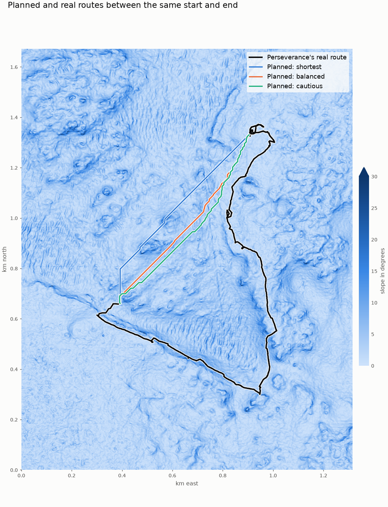

# Stage 3 notes: first version of the route planner

Written by Claude. The search code and all preference weights are Claude's first version, and the weights haven't been
reviewed or fitted to data.

## How it works

The planner uses A* search on the 1 m grid, moving between neighboring cells in 8 directions. Each move costs its ground
length times a cost per meter, made of three weighted parts: distance, energy, and hazard from ledges and roughness.

- **Off-limits and unknown cells can't be entered,** and diagonal moves can't squeeze between them.
- **Ledges only add cost,** following [Decision 1](decisions.md).
- **Long routes use a coarse pass first.** It finds a rough route on an 8 m grid, then searches at full detail near it.
  This can miss the best possible route. If the corridor fails, it widens, and finally the whole grid is searched.

| Preferences (provisional) | Distance | Energy | Hazard |
|---|---|---|---|
| Shortest | 1 | 0 | 0 |
| Balanced | 1 | 1 | 1 |
| Cautious | 1 | 0.5 | 5 |

## First results

From `python -m scripts.demo_planner`. This is a first look, not Stage 4's systematic comparison.

### One long stretch: the first 64 drives on the map

| Route | Length | Climb | Worst grade |
|---|---|---|---|
| Real | 2,613 m | 36.6 m | 19.5 degrees |
| Planned: shortest | 863 m | 24.9 m | 19.7 degrees |
| Planned: balanced | 863 m | 12.8 m | 7.8 degrees |
| Planned: cautious | 889 m | 11.0 m | 9.2 degrees |

The real route is about 3 times longer between these two points. Terrain doesn't appear to force the detour, since the
planner found a much shorter route, and the rover was probably visiting science targets. This hasn't been checked
against mission records. It shows that long stretches can't be compared fairly unless science stops are accounted for.

Balanced and cautious routes reduce climb by about half compared with shortest, for about the same length, so the
preferences do change the routes.

### 36 single drives of at least 20 m

| Method | Median length vs. real | Median distance from the real path |
|---|---|---|
| **Straight line (baseline)** | 0.933 | 2.9 m |
| Planned: shortest | 0.933 | 3.6 m |
| Planned: balanced | 0.933 | 3.0 m |
| Planned: cautious | 0.944 | 3.0 m |

**The planner doesn't beat a straight line here.** No straight line crossed off-limits or unknown ground, so these drives
were too easy to show what the planner adds. A low distance on its own doesn't show the planner is good.

## Limits and what Stage 4 needs

- **Fair comparison needs the right segments:** single drives are too easy, and long stretches include science detours.
  Stage 4 needs segments in between, and a straight-line baseline to beat.
- **Held-out drives:** some drives must be set aside before choosing any limits or weights.
- **Grid-shaped routes:** moving in 8 directions gives staircase-like paths, and routes can look odd, with long diagonals
  and sudden straight sections. The results above aren't smoothed. Stage 4 added smoothing, and
  [its results](stage4_development.md) replace the single-drive comparison here.
- **Weights are provisional:** Stage 5 is meant to estimate them from real drives.
- **Route endpoints:** these get moved to the nearest drivable cell when a real stop lands on blocked ground.
